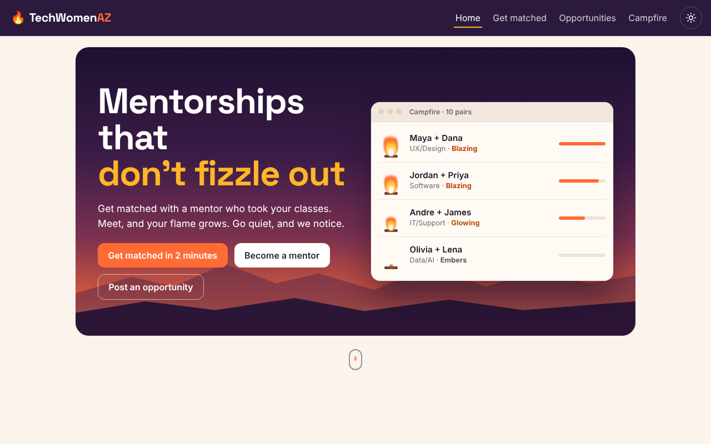
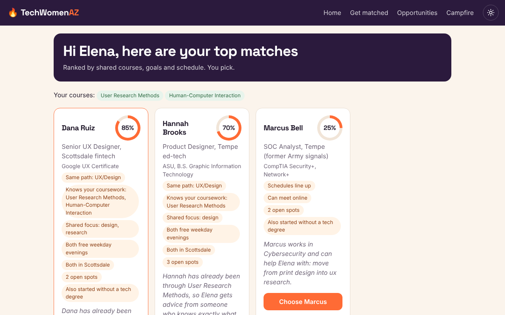
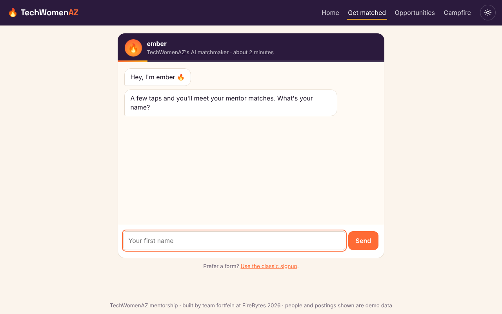
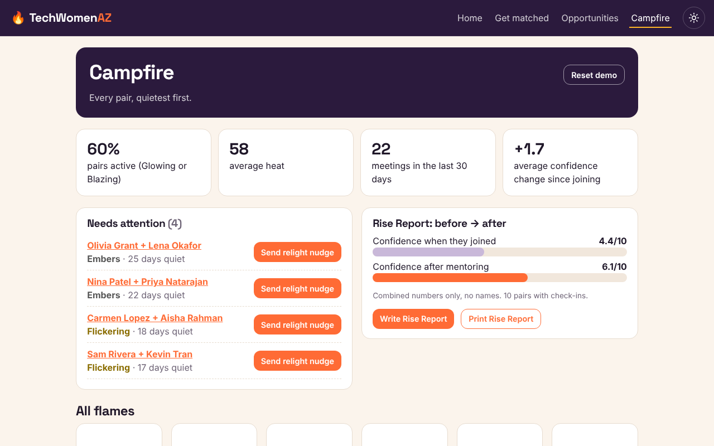

# 🔥 TechWomenAZ Mentorship: mentorships that don't fizzle out

Built for **TechWomenAZ** at the FireBytes Hackathon 2026 · **Team fortfein:** Bhuvan Potlapalli, Shaurya, Aadi, sventy77s

**Live app:** https://fortfein.firebytehack.workers.dev · **Video:** (add link)



## The problem
TechWomenAZ helps college students and adults (18+, not K-12) build careers in tech, with or without a tech degree, largely through mentorship. Matching mentees with mentors who have actually been through the same courses is slow and manual, pairs quietly stop meeting, and members struggle to find internships and jobs that fit what they've studied. Sponsors also want proof the program works.

## How it works
1. **Sign up by chatting with ember.** Paths: Software, UX/Design, Data/AI, Product, Cybersecurity, IT/Support, Tech Sales & Marketing, Engineering (pick a domain: Mechanical, Electrical, Civil, Chemical, Biomedical, Aerospace, Industrial, Computer, Environmental, Software, or type your own), Cloud/DevOps, Game Design, Health Tech, Fintech, Not sure yet, or Other (type it). Instead of a long survey, ember (the AI matchmaker at `/start`) asks a few quick questions with tap-to-answer chips: your name, mentor or mentee, which field of tech you're going into (or "not sure yet", then what interests you), and which courses you've taken, picked from a **curated course list for that field**. Ember reacts to your answers with AI. A classic form is still at `/join`.
2. **Coursework-first matching.** Mentees get their top 3 mentors ranked by shared coursework, career path, goals, schedule, format and open capacity. AI explains why each pair will click. The page also shows **courses to take next** for your field and which mentors took each one.
3. **The Flame.** Every pair has a flame. Logging a meeting (one emoji, one takeaway, one next step) makes it grow, silence makes it fade:
   `heat = clamp(100 − 4 × days since last meeting + 5 × weekly streak, 0, 100)` → Blazing / Glowing / Flickering / Embers. Every pair gets 3 AI-suggested milestones, and "Write my next meeting agenda" drafts the next meeting.
4. **The Campfire** (admin, `/campfire`). Every pair as a flame, weakest first, a "Needs attention" list with one-click relight nudges, program stats, and a before/after confidence **Rise Report** (AI writes a sponsor-ready summary from combined numbers only, and is told never to invent numbers).
5. **Opportunities board** (`/opportunities`). Employers and partners post internships, jobs and mentorship programs with the coursework they want. Each student's fit is scored by coursework coverage, mentees see the openings they fit, and posters see their best-fit students.
6. **Courses** (`/courses`). Mentors share classes they teach or recommend, and employers add prep courses for their postings, each with filter tags. Students filter by path, level, cost, format and tags, or type their goal to see the best-fit courses first, then open a course, press **Start course**, tick off lessons (progress is saved) and save it to **My saved courses**. On every opportunity, **ember (Workers AI) reads what the posting wants and picks the courses that cover it**, with the employer's own prep courses shown first. **Personalized by ember:** a mentor picks a mentee and ember (Workers AI) writes a 4-step course for that person from their classes and goal, linked to library courses, with step checkboxes that track progress (the pair page links straight to it).
7. **A fun question.** ember also asks what you're into off the clock (gaming, hiking, music…). Shared interests add up to 10 points to a match, as a tiebreaker after coursework.
8. **Design.** The home page is a full-screen scroll story (Start → Why → Match → Meet → Learn → Launch → Join) with drifting embers, a glowing thread that connects every section as you scroll, and a fire that grows as you scroll through Meet. Light/dark toggle, page-to-page transitions tied to each button, clickable flames that throw sparks, and a phone-friendly layout.

| Matches by shared coursework | Chat signup with ember | Campfire dashboard |
|---|---|---|
|  |  |  |

### Scoring (simple and explainable)
| Mentor match | Points | Opportunity fit | Points |
|---|---|---|---|
| Same career path | 30 | Same career path | 30 |
| Shared coursework | up to 30 | Share of wanted courses taken | up to 60 |
| Goal keywords | up to 15 | Location / remote works | 10 |
| Availability | 10 | | |
| Format / area | 5 | | |
| Mentor has open capacity | 10 | | |
| Shared fun interests | up to 10 (total capped at 100) | | |

## Tech stack
- **Cloudflare Workers** (TypeScript, no framework): server-rendered pages + JSON endpoints, one deploy.
- **Cloudflare D1** (SQLite): users, pairs, milestones, check-ins, nudges, opportunities.
- **Workers AI**, model **`@cf/google/gemma-4-26b-a4b-it`** (thinking off, short answers): ember's chat reactions, matching courses to each opportunity's wants, "why you'll click" match explanations, milestones, meeting agendas, the Rise Report. All AI calls run in the Worker, never in the browser. Every call has an 8-second timeout and a template fallback, so the app never breaks.
- View Transitions API and plain CSS/JS for the animations (no libraries).

| File | Purpose |
|---|---|
| `src/index.ts` | Router |
| `src/chat.ts` | ember chat signup |
| `src/courses.ts` | Course library, filters, ember's course picks for opportunities |
| `src/personal.ts` | Personalized courses built by ember for one mentee |
| `src/pages.ts` | Pages, forms, JSON endpoints |
| `src/db.ts` | Schema, demo seed data, queries (all parameterized) |
| `src/logic.ts` | Flame, match and opportunity-fit formulas, curated course library |
| `src/ai.ts` | Workers AI calls with fallbacks |
| `src/ui.ts` | Layout, styles, light/dark theme, transitions, the CSS flame |

## How to run it
```bash
npm install
npx wrangler dev -c wrangler.mock.jsonc   # local, no Cloudflare login needed (AI uses templates)
# open http://localhost:8787
```
Deploy:
```bash
npx wrangler d1 create ember-db           # paste the database_id into wrangler.jsonc
npx wrangler deploy
```
Tables and demo data are created automatically on the first request. The **Reset demo** button on `/campfire` reloads the demo data. Try `/matches/19` (Elena, a UX mentee) for the demo.

## Status
- ✅ **Finished:** ember chat signup with curated courses, classic signup form, coursework matching, pairs, milestones, meeting logs, flames, Campfire dashboard, relight nudges (saved), Rise Report, opportunities board with coursework fit, course library with filters, AI course picks per opportunity, every AI feature with fallbacks, light/dark mode, mobile layout.
- 🧪 **Mocked:** nudges are saved and shown, not emailed. There are no logins, so anyone with a link can open any page. People, pairs and postings are **fictional demo data** (postings and courses are marked "(demo)" or credited to demo people).
- 🔜 **Next:** logins for mentors, mentees and admins; real email/SMS nudges; Speed Spark matching at live events; "Pass the Torch" (mentees who reach their goal become mentors); a mentor course library with public/members-only sharing.

## Assumptions
- Mentees are college students or adults (18+); TechWomenAZ does not serve K-12.
- Pairs should meet about weekly; a flame fades after ~1–2 quiet weeks.
- Course names are free text; matching uses shared keywords ("Intro to Python" ≈ "Python for Data Science") and ignores generic words like "intro" or "computer".

## Privacy & safety
Data consent at signup · 18+ only · meetings online or in public, contact details private until both agree · opportunity posters see fit, not contact details · the Rise Report uses combined, anonymous numbers only · every query is parameterized and all user text is HTML-escaped.
